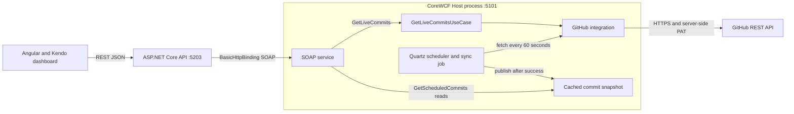

# GitHub Repository Monitor

A full-stack technical assignment that displays the latest commits from a
configured GitHub repository. An Angular dashboard reads an ASP.NET Core REST
API, which calls CoreWCF SOAP services. Live reads fetch GitHub immediately;
Quartz refreshes a separate in-memory snapshot every 60 seconds.

The implementation includes authenticated GitHub access, live and scheduled
commit endpoints, background synchronization, and an Angular dashboard using
Kendo Grid, Dialog, and Buttons. There is no database.

## Technology stack

Versions below come from project files and `frontend/package-lock.json`.

| Component        | Version / configuration                                            |
| ---------------- | ------------------------------------------------------------------ |
| Backend          | .NET / ASP.NET Core 8 (`net8.0`)                                   |
| SOAP server      | CoreWCF HTTP / Primitives 1.9.1                                    |
| SOAP client      | System.ServiceModel.Http 8.1.2                                     |
| Scheduler        | Quartz.Extensions.Hosting 3.22.7                                   |
| OpenAPI          | Microsoft.AspNetCore.OpenApi 8.0.32; Swashbuckle 6.6.2             |
| Frontend         | Angular core 22.2.3; CLI / build 22.2.4                            |
| UI               | Kendo Angular Grid / Dialog / Buttons 25.3.0; default theme 14.7.0 |
| Licensing        | @progress/kendo-licensing 1.11.3                                   |
| Language / tests | TypeScript 6.0.3; Vitest 5.0.5; xUnit 2.5.3                        |
| Tooling          | npm 11.19.0 declared; Prettier 3.9.10 locked                       |

A scoped [npm override](https://docs.npmjs.com/cli/v11/configuring-npm/package-json/#overrides)
selects Vite **8.3.3** for `@angular/build`, replacing its vulnerable 8.3.0 pin.
No newer Angular 22.2.x build/CLI patch was available when checked on
2026-10-26. Angular versions stay unchanged; this locally overrides the upstream
pin, with compatibility checked by the frontend build/tests rather than an
assertion of Angular endorsement.

## Architecture

Domain holds the commit model. Application defines the live use case and
provider and snapshot abstractions. Infrastructure implements GitHub HTTP access
and the snapshot store. The CoreWCF Host composes these layers and hosts Quartz.
The API owns a compatible SOAP client contract and has no project reference to
the host or Infrastructure.

Project dependencies point inward: Application references Domain; Infrastructure
references Application; the host references Application, Infrastructure, and
Wcf.Contracts. Wcf.Contracts has no project references. Runtime REST-to-SOAP
calls cross a process boundary.



Arrows represent requests or store access; results return along the calling
path. Quartz and the SOAP service share one singleton store in the host. See
[architecture](docs/architecture.md) and [decisions](docs/decisions.md).

## Prerequisites

- .NET 8 SDK, matching backend CI, with the .NET 8 / ASP.NET Core runtime. There
  is no `global.json`; this audit also built with SDK 10.0.402 and the installed
  .NET 8 runtime.
- Node.js 24.15 or later in the 24.x family and npm 11.19.0. CI uses Node 24;
  the locked Angular CLI accepts `^22.22.3 || ^24.15.0 || >=26.0.0`.
- Git and access to NuGet and npm registries. The local Angular CLI is installed
  by `npm ci`; a global CLI is unnecessary.
- A GitHub PAT with access to the selected repository. For a fine-grained token,
  grant repository **Contents: read**, as required by
  [GitHub's list-commits endpoint](https://docs.github.com/en/rest/commits/commits#list-commits).
- An active Telerik/Kendo trial or commercial license. The current delivery uses
  a time-limited trial; the reviewer needs their own valid activation.

## Quick start (PowerShell)

Run from the repository root. Keep the host, API, and Angular in separate
terminals. These commands explicitly select the Development HTTP profiles.

### 1. Restore and build

```powershell
dotnet restore GitHubRepositoryMonitor.sln
dotnet build GitHubRepositoryMonitor.sln
```

### 2. Start CoreWCF and Quartz

Enter the actual branch name for the repository selected below. The human-run
private demo verification used `feature/github-integration`; the checked-in
Development default remains `develop`. Choose the branch explicitly. Enter the
PAT at the masked prompt; it stays in the current
process environment, outside source files and command history:

```powershell
$env:ASPNETCORE_ENVIRONMENT = 'Development'
$env:GitHub__Owner = 'company'
$env:GitHub__Repository = 'integration-task-private-repo'
$env:GitHub__Branch = Read-Host 'Actual GitHub branch name'
if ([string]::IsNullOrWhiteSpace($env:GitHub__Branch)) {
    throw 'Enter the actual branch name before starting the host.'
}
$env:GitHub__Token = [System.Net.NetworkCredential]::new('', (Read-Host 'GitHub PAT' -AsSecureString)).Password
try {
    dotnet run --project src/GitHubMonitor.Wcf.Host --launch-profile http --urls http://localhost:5101
} finally {
    Remove-Item Env:\GitHub__Token -ErrorAction SilentlyContinue
}
```

The assignment names `company/integration-task-private-repo`; employer access
has not been supplied or verified in this session. Checked-in Development
defaults select the alternative demonstration target
`abdelrahman-nasser/github-repository-monitor`, branch `develop`. Human-supplied
direct GitHub REST verification confirms `private: true`, authenticated read
passed, and 10 commits returned for `feature/github-integration`. To use that
verified demo branch, explicitly select that owner/repository and enter
`feature/github-integration` above. This is not a new application end-to-end run
or independent proof of read-only token scope. Employer access remains
unverified. See the
[delivery evidence](docs/delivery-checklist.md#human-run-direct-github-rest-verification).
Exact keys are in
[configuration and licensing setup](docs/setup.md).

Windows PowerShell 5.1 removes an environment variable assigned `''`, so that
assignment would leave the checked-in `develop` branch in effect. The explicit
nonblank branch above overrides that setting without relying on empty values.

### 3. Start REST API

```powershell
$env:ASPNETCORE_ENVIRONMENT = 'Development'
$env:Wcf__EndpointUrl = 'http://localhost:5101/GitHubMonitorService.svc'
dotnet run --project src/GitHubMonitor.Api --launch-profile http --urls http://localhost:5203
```

The explicit URL matters: the checked-in API HTTP profile defaults to **5080**.
The Angular proxy and the previously verified setup use **5203**.

### 4. Install and activate the frontend

```powershell
Set-Location frontend
npm ci
npx kendo-ui-license refresh
npx kendo-ui-license activate
```

`refresh` opens Telerik sign-in and downloads a key to the user profile. If a
current key is already provisioned there, run only `activate` after
installation. Keep license files outside the repository. See
[Telerik's activation instructions](https://www.telerik.com/kendo-angular-ui/components/licensing).

### 5. Start the dashboard in real API mode

```powershell
npm start -- --configuration development-api --host localhost --port 4200
```

Open [the dashboard](http://localhost:4200). Useful service links:
[host health](http://localhost:5101/health),
[SOAP WSDL](http://localhost:5101/GitHubMonitorService.svc?wsdl), and
[Development Swagger](http://localhost:5203/swagger). The HTTP setup is for
local development; the services have no caller authentication and the SOAP
binding has no transport security configured.

## Configuration

The host reads `GitHub:Owner`, `GitHub:Repository`, `GitHub:Branch`, and
`GitHub:Token`. Owner, repository, and token must be nonblank at startup. The
API reads required `Wcf:EndpointUrl`, whose Development value is
`http://localhost:5101/GitHubMonitorService.svc`. Double underscores map
environment variables to configuration sections, for example `GitHub__Token` and
`Wcf__EndpointUrl`.

The token belongs only in the host process. Angular contains no credentials. See
[setup](docs/setup.md) for all defaults, precedence, frontend configuration, and
the CI licensing step and required manual secret provisioning.

## REST and SOAP contracts

| REST endpoint               | SOAP operation        | `data` on success                                       |
| --------------------------- | --------------------- | ------------------------------------------------------- |
| `GET /api/github/live`      | `GetLiveCommits`      | Array of up to 10 commits fetched from GitHub           |
| `GET /api/github/scheduled` | `GetScheduledCommits` | Object containing `commits` and nullable `lastSyncTime` |

Both REST operations return
`{ "success": true, "message": "...", "data": ... }`. Success messages are
`Live commits retrieved successfully.` and
`Scheduled commits retrieved successfully.` respectively.

| Commit field | Meaning                                               |
| ------------ | ----------------------------------------------------- |
| `sha`        | Full Git commit SHA                                   |
| `message`    | Commit message                                        |
| `author`     | Author name, with committer name / `Unknown` fallback |
| `date`       | UTC commit date serialized as an ISO timestamp        |
| `source`     | `Live` or `Scheduled`, assigned by the SOAP service   |

Before the first successful synchronization, the scheduled response is:

```json
{
  "success": true,
  "message": "Scheduled commits retrieved successfully.",
  "data": { "commits": [], "lastSyncTime": null }
}
```

Handled errors use `success: false`, a sanitized `message`, and `data: null`.
Typed SOAP faults preserve GitHub failure classification. The API maps upstream
GitHub authentication rejection to **502**, upstream timeouts to **504**, WCF
availability/communication failures to **503**, and unexpected failures to
**500**. A SOAP-client timeout is also **504** with a distinct message. These
are server integration failures; no frontend login is required. See the exact
safe messages and wire-test evidence in [architecture](docs/architecture.md).

SOAP uses `http://localhost:5101/GitHubMonitorService.svc`, BasicHttpBinding,
and service namespace `http://tempuri.org/`. The contract also retains `Ping`;
SOAP responses are DTOs rather than the REST envelope. The checked-in API
`.http` file is an old template; use the routes above or Swagger.

## Scheduler and dashboard behavior

Quartz starts with the CoreWCF Host, requests an immediate first sync, then
repeats every minute. The job prevents overlapping executions. It requests up to
10 commits and publishes a new snapshot with UTC `LastSyncTime` only after a
successful fetch, including a successful empty result.

The store starts with an empty list and a null timestamp. It is thread-safe,
process-local, nonpersistent, and has no TTL. Restarting the host clears it.
Failed refreshes are logged and preserve the previous snapshot and timestamp;
the next scheduled execution tries again. Old data can therefore remain
indefinitely while GitHub is unavailable. Live reads never update this store.

Both dashboard sections load on entry. **Refresh Live Data** fetches GitHub again;
**Refresh snapshot** rereads the cache. There is no frontend polling timer.
Kendo Grids show commit fields with resizable columns, keyboard navigation, and
full-SHA disclosure. Kendo Buttons disable during the corresponding request.
Loading, empty, unsynchronized, and error states are distinct; errors use a
Kendo Dialog and retain previously displayed data. The synchronization timestamp
is shown in browser local time. Frontend request timeout is 25 seconds.

For offline mock mode, run `npm start` from `frontend`. Production builds use
real relative `/api` URLs and need a hosting route to the API. See the
[frontend guide](frontend/README.md) for mock scenarios and mode selection.

## Verification and CI

From the repository root:

```powershell
dotnet build GitHubRepositoryMonitor.sln
dotnet test GitHubRepositoryMonitor.sln
Set-Location frontend
npm ci
npm run build
npm test -- --watch=false
npm test -- --watch=false --configuration production
npx tsc -p tsconfig.app.json --noEmit --noUnusedLocals --noUnusedParameters
npx tsc -p tsconfig.spec.json --noEmit --noUnusedLocals --noUnusedParameters
npx prettier . --check
```

[Testing](docs/testing.md) explains suite selection and limitations.
[The delivery checklist](docs/delivery-checklist.md) records exact audit
results, the requirements matrix, and historical end-to-end evidence separately.

- [Backend CI](.github/workflows/backend-ci.yml): Windows, .NET 8 restore,
  Release solution build, and all backend tests. No formatting step.
- [Frontend CI](.github/workflows/frontend-ci.yml): Ubuntu, Node 24, lockfile
  `npm ci`, production build, development and focused production tests, strict
  app/spec TypeScript checks, and frontend/workflow Prettier checks.

Frontend CI activates Telerik licensing after installation for trusted builds
when `TELERIK_LICENSE` is supplied. The key is scoped to that activation step.
Missing keys and untrusted PRs are explicitly reported; build and test checks
still run. Manual secret provisioning remains pending; see [setup](docs/setup.md).

## Known limitations

- Kendo uses a time-limited trial. Local activation does not activate CI.
- The Angular initial bundle exceeds its warning budget; this is non-blocking.
  The lazy Kendo dashboard bundle is also relatively large. Budgets are
  unchanged.
- Current desktop and narrow-screen browser results are recorded separately in
  the [delivery checklist](docs/delivery-checklist.md).
- Windows Smart App Control has intermittently blocked locally compiled unsigned
  .NET assemblies on the development machine. Current gate results and any
  environment failures are recorded in the delivery checklist.
- The cache is volatile, single-host, and can serve stale data without an age
  limit.
- Automated integration tests cross a real local SOAP boundary using a fake
  upstream. Alternative private-repository access is verified by the human-run
  direct API check; employer access, a new application end-to-end run, and hosted
  CI remain unverified.
- The three-page original PDF was reviewed on 2026-10-26. Its overview and
  detailed scheduler diagrams differ; this implementation follows the detailed
  Quartz-to-GitHub-to-cache flow. CoreWCF is our implementation choice for WCF
  on .NET 8, with no claim of explicit employer approval. Three days is the
  recommended completion time, rather than a contractual deadline.

## Repository structure

```text
GitHubRepositoryMonitor/
|-- .github/workflows/          # Backend and frontend CI
|-- src/
|   |-- GitHubMonitor.Domain/
|   |-- GitHubMonitor.Application/
|   |-- GitHubMonitor.Infrastructure/
|   |-- GitHubMonitor.Wcf.Contracts/
|   |-- GitHubMonitor.Wcf.Host/
|   `-- GitHubMonitor.Api/
|-- tests/
|   |-- GitHubMonitor.Infrastructure.Tests/
|   |-- GitHubMonitor.Wcf.Host.Tests/
|   `-- GitHubMonitor.Api.Tests/
|-- frontend/                   # Angular workspace and locked npm dependencies
|   `-- src/app/                # Dashboard, shared components, API service/mocks
|-- docs/                       # Architecture, setup, testing, delivery evidence
|-- GitHubRepositoryMonitor.sln
`-- README.md
```

## Reviewer guide

1. Follow Quick start to run the host on 5101, API on 5203, and UI on 4200.
2. Call `Invoke-RestMethod http://localhost:5203/api/github/live` and
   `Invoke-RestMethod http://localhost:5203/api/github/scheduled`.
3. Inspect both Kendo Grids and refresh buttons in real API mode.
4. Read the scheduled timestamp twice more than a minute apart; successful
   Quartz runs should advance it even when the commit list is unchanged.
5. Run the commands above, then review the
   [delivery matrix and outstanding actions](docs/delivery-checklist.md).
